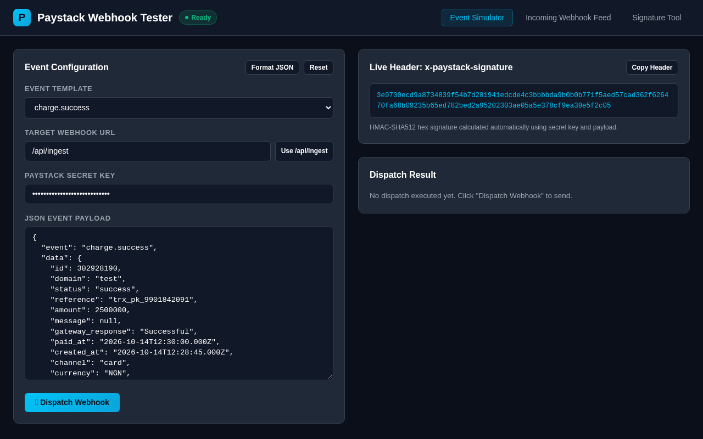

# Paystack Webhook Tester

A local simulator for Paystack webhooks. Pick a realistic event, sign it with your test secret key exactly as Paystack does (`x-paystack-signature`, HMAC-SHA512), send it to your own endpoint and see what came back. It also has a built-in receiver that shows what arrived and whether the signature checks out.

It has no runtime dependencies and comes as a web dashboard, a CLI and a small TypeScript library.



**Live demo:** https://paystack-webhook-tester.lab.linkfa.de (a lab demo that runs in self-only mode and stays up for 14 days)

## What it does

Paystack Webhook Tester gives developers and Nigerian businesses a clean, zero-dependency local simulator and UI for testing Paystack webhook payloads with real HMAC-SHA512 signatures. It lets you select event templates, edit payloads, verify signatures, test handlers locally without public tunnels, and inspect incoming webhook events in real time.

## Why

Your Paystack webhook handler is the code that marks an order as paid, so it needs testing. Testing it against real sandbox payments is slow. You also can't easily make Paystack send a `transfer.failed` or an `invoice.payment_failed` on demand, and you need a public tunnel before anything can reach `localhost`. This tool sends the same request Paystack would send, signed the same way, straight to `http://localhost:3000/your/webhook`:

- **Event templates** with NGN amounts, customer details and channels for `charge.success`, `transfer.success`, `transfer.failed`, `transfer.reversed`, `invoice.create`, `invoice.payment_failed` and `subscription.create`. You can edit any field before sending.
- **Signing:** the `x-paystack-signature` header is recomputed live as you edit the payload.
- **Dispatch:** each send shows the status code, the latency, the headers sent and the response body.
- **Receiver:** `POST /api/ingest` keeps the last 100 webhooks it receives and checks each signature. Point another sender at it to inspect its payloads.
- **Signature tool:** paste a payload, a header and a key to find out whether they match. The comparison is timing-safe.

## Install

Requires Node.js 20 or newer.

```bash
git clone https://github.com/ibro1/paystack-webhook-tester.git
cd paystack-webhook-tester
npm install --include=dev
npm run build
```

Or with Docker:

```bash
docker build -t paystack-webhook-tester .
docker run --rm -p 3000:3000 paystack-webhook-tester
```

## Usage

### Dashboard

```bash
node dist/src/cli.js serve --port 3000 --secret sk_test_your_key
```

Open http://localhost:3000, choose an event, type your endpoint's URL in **Target webhook URL** and press **Dispatch Webhook**. Leave the target as `/api/ingest` to send the event to the tester itself and watch it in **Incoming Webhook Feed**.

Use only your **test** secret key (`sk_test_...`). The default key is a placeholder, and the server keeps nothing on disk.

### CLI

```bash
# List the event templates
node dist/src/cli.js templates

# Send a signed charge.success to your handler
node dist/src/cli.js dispatch --event charge.success \
  --target http://localhost:8000/paystack/webhook --secret sk_test_your_key

# Print the signature for a payload
node dist/src/cli.js sign --payload '{"event":"charge.success"}' --secret sk_test_your_key

# Check a signature (exit code 0 when valid, 1 when not)
node dist/src/cli.js verify --payload '{"event":"charge.success"}' \
  --signature <hex> --secret sk_test_your_key
```

`PAYSTACK_SECRET_KEY` can be used in place of `--secret`.

### Library

After `npm run build`, the functions are exported from `dist/src/index.js`:

```ts
import { getTemplate, verifySignature, dispatchWebhook } from './paystack-webhook-tester/dist/src/index.js';

const payload = JSON.stringify(getTemplate('transfer.failed'));
const result = await dispatchWebhook({
  targetUrl: 'http://localhost:8000/paystack/webhook',
  payload,
  secretKey: process.env.PAYSTACK_SECRET_KEY!,
});
console.log(result.statusCode, result.latencyMs, result.responseBody);

// In your own handler: verify against the raw body, not re-serialised JSON
verifySignature(rawBody, req.headers['x-paystack-signature'], secretKey);
```

### Self-only mode

`serve --self-only` (or `DISPATCH_SELF_ONLY=1`) refuses every target outside the server, so a public instance can't be used to send requests to other hosts. The demo runs this way. On your own machine, leave it off.

### HTTP API

| Method | Path | What it does |
| --- | --- | --- |
| GET | `/api/templates` | Names of the event templates |
| GET | `/api/templates/:event` | One template's payload |
| POST | `/api/sign` | `{ payload, secretKey }` → `{ signature }` |
| POST | `/api/verify` | `{ payload, signature, secretKey }` → `{ valid }` |
| POST | `/api/dispatch` | `{ targetUrl, payload, secretKey }` → status, latency, headers, body |
| POST | `/api/ingest` | Receive a webhook and check its signature |
| GET / DELETE | `/api/history` | Read or clear what `/api/ingest` received |
| GET | `/api/health` | Health check |

## Development

```bash
npm install --include=dev
npm test
```

The acceptance tests in [SPEC.md](SPEC.md) live in `test/` and run with Node's built-in test runner. To rebuild the lab demo's compose file, run `npm run build && node scripts/make-demo-compose.mjs > docker-compose.demo.yml`.

## Licence

[MIT](LICENSE) © ibro1. This is an independent project, not affiliated with or endorsed by Paystack.
